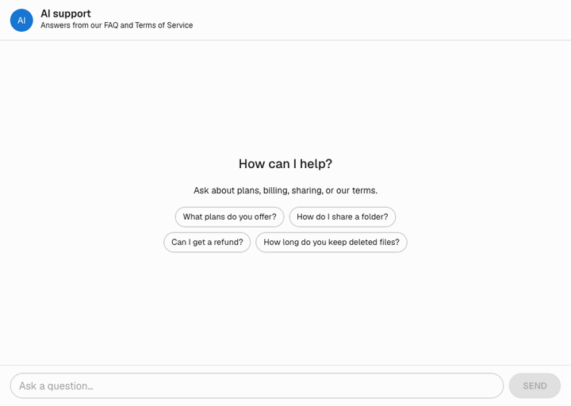

# ai-chat

An AI customer support chat that answers questions from your own knowledge base. Load an FAQ and Terms of Service, ask a question in the browser, and get a short answer streamed back, along with the documents it was based on. If the knowledge base doesn't cover the question, the assistant says so instead of making something up.



## How it works

```
question ─► embed (bge-small) ─► top-5 cosine search (pgvector) ─► LLM prompt with context (Groq) ─► streamed answer + sources
```

1. **Ingestion**: `app.ingest` reads `faq.json` (one document per Q&A) and `tos.md` (one document per section, long sections split into chunks), embeds them with [fastembed](https://github.com/qdrant/fastembed) (`BAAI/bge-small-en-v1.5`, 384 dims) and stores them in Postgres with pgvector. Re-running it replaces each source, so it is idempotent.
2. **Retrieval**: the question is embedded the same way and the 5 closest documents are found by cosine similarity (HNSW index).
3. **Answering**: the documents go into the system prompt, and a Groq-hosted LLM (default `openai/gpt-oss-120b`) answers using only that context.
4. **Streaming**: `POST /chat` returns Server-Sent Events, each a JSON object with a `type`: `sources` first, then a `token` per text chunk, then `done`. If something fails mid-stream, an `error` event replaces the rest. The event types are part of the OpenAPI spec.
5. **UI**: a Next.js chat page built with MUI shows the answer as it streams in (rendered as Markdown), with the sources as chips under it. It calls the backend through a TypeScript client generated from the OpenAPI spec.

The sample data in `backend/data/` describes a made-up cloud storage service. Swap in your own `faq.json` / `tos.md` and re-run the ingestion.

## Tech stack

- `backend/`: Python 3.14, FastAPI, async SQLAlchemy, Alembic, Postgres + pgvector, fastembed, Groq SDK, structlog; managed with [uv](https://docs.astral.sh/uv/)
- `frontend/`: Next.js, React, TypeScript, MUI, an API client generated with [openapi-ts](https://heyapi.dev/), Vitest, oxlint and oxfmt; managed with pnpm

The two projects are independent, with no shared tooling.

## Getting started

You need Docker, uv, pnpm and a [Groq API key](https://console.groq.com/keys).

```sh
cp backend/.env.example backend/.env                         # then set GROQ_API_KEY
docker compose up -d db                                      # Postgres + pgvector
cd backend
uv sync
uv run alembic upgrade head                                  # create the schema
uv run python -m app.ingest data/                            # load the sample knowledge base
uv run uvicorn app.main:create_app --factory --reload        # http://localhost:8000
# in a second terminal:
cd frontend && pnpm install && pnpm dev                      # http://localhost:3000
```

Or run the backend in Docker as well with `docker compose up -d --build` (it applies migrations on start). Ingest the data from `backend/` as above.

### Configuration

Backend settings come from `backend/.env` (see `backend/.env.example`):

| Variable | Default | Description |
|---|---|---|
| `DATABASE_URL` | (required) | Postgres connection string (asyncpg) |
| `GROQ_API_KEY` | (empty) | Groq API key; `/chat` fails without it |
| `GROQ_MODEL` | `openai/gpt-oss-120b` | Groq model used for answers |
| `CHAT_RATE_LIMIT_PER_MINUTE` | `20` | `/chat` requests allowed per client IP per minute (in-process) |
| `LOG_LEVEL` | `INFO` | Log level |
| `CORS_ORIGINS` | `["http://localhost:3000"]` | JSON list of allowed browser origins |

The frontend reads `NEXT_PUBLIC_API_URL` (default `http://localhost:8000`).

## API

| Endpoint | Description |
|---|---|
| `POST /chat` | `{"question": "..."}` → SSE stream of `sources`, `token`, `done` / `error` events |
| `GET /health` | Liveness: the process is up |
| `GET /health/ready` | Readiness: the database is reachable |
| `GET /openapi.json` | OpenAPI spec, used to generate the frontend client |

Interactive docs are at http://localhost:8000/docs.

### Frontend API client

`frontend/src/client/` is generated from the backend's OpenAPI spec and committed, so building the frontend doesn't need a running backend. Don't edit it by hand; after changing the API, regenerate it in `frontend/`:

```sh
pnpm generate:api                                            # reads http://localhost:8000/openapi.json
OPENAPI_URL=../openapi.json pnpm generate:api                # or a file from `uv run python -m app.export_openapi`
```

CI fails if the committed client doesn't match the backend.

## Development

Backend checks (run in `backend/`; tests need the DB running and use their own `<db>_test` database, created and migrated automatically):

```sh
uv run ruff format --check . && uv run ruff check . && uv run mypy .
uv run pytest
```

Migrations (run in `backend/`; the DB must be at head first):

```sh
uv run alembic upgrade head                                  # apply pending migrations
uv run alembic check                                         # fails if models changed without a migration
uv run alembic revision --autogenerate -m "add users"        # generate one, then review it
```

Frontend checks (run in `frontend/`):

```sh
pnpm format:check && pnpm lint && pnpm test && pnpm build      # `pnpm format` fixes formatting
```

CI (`.github/workflows/ci.yml`) runs all of these, `alembic check`, and the generated client check.
